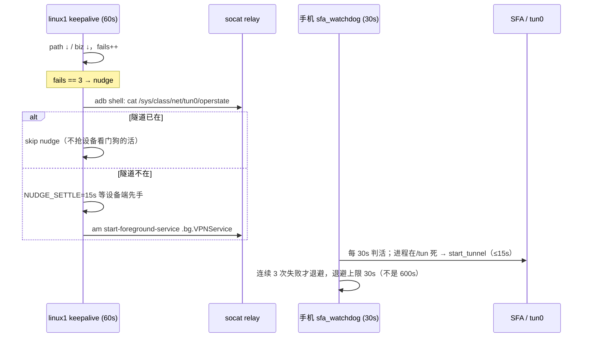

# OPS — redmi-wxpad 导出端点的可用性守护

本文只讲**链路可用性**：手机（redmi-wxpad）→ tailnet → linux1 消费者。
数据面契约见 [`DATA_CONTRACT.md`](DATA_CONTRACT.md)，部署见 [`DEPLOY.md`](DEPLOY.md)。

## 1. 角色

| 位置 | 组件 | 职责 |
|---|---|---|
| 手机 | `wx_daemon` (`127.0.0.1:8765`) | 导出服务本体（鉴权、失败关闭） |
| 手机 | SFA / sing-box (`io.nekohasekai.sfa`) | tailnet 出口隧道，提供 `100.80.174.96` |
| 手机 | [`deploy/device/sfa_watchdog.sh`](../deploy/device/sfa_watchdog.sh) | Magisk `service.d` 常驻：解锁门禁 + 隧道自愈 |
| linux1 | [`deploy/host/redmi-tailnet-keepalive`](../deploy/host/redmi-tailnet-keepalive) | 60s 探针：路径 + 业务双判据、第 3 轮 adb 直启、报警 |
| linux1 | `socat` relay (`100.67.218.81:5555` → `Redmi-10X.lan:5555`) | 独立于 tailnet 的 adb 控制/回退通道 |

## 2. 就绪判据（两条独立判据，缺一不可）

| 判据 | 表达 | 说明 |
|---|---|---|
| `path` | `tailscale ping 100.80.174.96` 有 pong | tailnet 可路由（DERP 或 direct） |
| `biz` | `GET http://100.80.174.96:8765/health` 返回**任意** HTTP 状态码 | 401/403 也算活着；仅连接失败/超时记 `000` |

`biz` 之所以不要求 200：本仓库部署的 daemon 对 `/health` 也可能返回 401，
把判据写成"非 000 即活"才不会因鉴权策略收紧而误报（历史漂移见 §6）。

## 3. 自愈时序



关键不变量：

* **解锁门禁**：`am get-started-user-state 0 == RUNNING_UNLOCKED` 之前不碰 SFA。
  `/data` 在 FBE 凭据加密区，锁屏时 SFA 打开 Room/SQLite 必然 `SQLITE_CANTOPEN`。
* **先判设备再动作**：host 端 nudge 前先读设备 `tun0`，并在 `NUDGE_SETTLE` 后复查；
  两次 `startForegroundService` 并发会触发 `ForegroundServiceDidNotStartInTimeException`（ANR 杀进程）。
* **退避有界**：600s 退避会把"用户已解锁"这件事晾 6 分钟，上限固定 30s。
* **判活分离**：进程活 ≠ 隧道活；`tun0` 存在且 `operstate != down`（Android 上常为 `unknown`，视为 UP）。

## 4. 部署

```bash
# linux1
scp deploy/host/redmi-tailnet-keepalive linux1:/tmp/
ssh linux1 'sudo install -m 0755 /tmp/redmi-tailnet-keepalive /usr/local/bin/'

# 手机（经 relay；改前先备份）
A="adb -s 100.67.218.81:5555"
$A push deploy/device/sfa_watchdog.sh /data/local/tmp/sfa_watchdog.sh.new
$A shell 'su -c "cp -a /data/adb/service.d/sfa_watchdog.sh /data/local/tmp/$(date +%s).bak
  && install -m 0755 /data/local/tmp/sfa_watchdog.sh.new /data/adb/service.d/sfa_watchdog.sh"'
# 重启看门狗：kill $(cat /data/local/tmp/sfa_watchdog.pid)，再 setsid nohup sh 启动
```

两个脚本的所有路径与节拍都可用环境变量覆盖（`SFA_*` / `KEEPALIVE_*`），
测试依赖这些 seam 在 stub PATH 下驱动状态机，见
[`tests/test_ops_scripts.py`](../tests/test_ops_scripts.py)。

## 5. 故障史（证据）

| 日期 | 现象 | 根因 | 修复 |
|---|---|---|---|
| 2026-10-23 | 青龙 3 轮超时，`tx` 有量 `rx` 为 0 | WiFi 重连后 tailscaled 持有陈旧 direct endpoint；设备看门狗只校验进程/tun0 | 设备侧加 tailnet 探测 + 冷却重启；host 侧加 keepalive |
| 2026-11-04 | 92 分钟不可用，探针连续 95 轮失败 | 19:50 重启后 SFA 在 **FBE 锁屏态** 被盲拉，7 连崩且 `SQLITE_CANTOPEN`；600s 退避又把 21:22:58 的解锁晾到 21:29 | 解锁门禁 + 退避上限 30s + host nudge 改为真实 `am start-foreground-service` |

## 6. 已知限制（不要用"自动恢复"承诺掩盖）

* **锁屏时无解**：FBE 未解锁前任何自动补救都不可能成功。告警文案必须写"需人工解锁"。
* **ANR 窗口**：force-stop 后首次 `startForegroundService` 可能因初始化超 5s 被杀；
  每 30s 重试一次即可自愈（实测注入后 46s 恢复）。
* **relay 依赖 DHCP 名**：`socat` 目标为 `Redmi-10X.lan`；请在路由器为该机固定租约，
  否则 IP 漂移会同时打断控制通道与 LAN 回退。
* **文档漂移**：`DATA_CONTRACT.md` 声明 `/health` 免鉴权，实测部署实例返回 401。
  探针口径以"非 000 即活"为准，两者需保持同步。