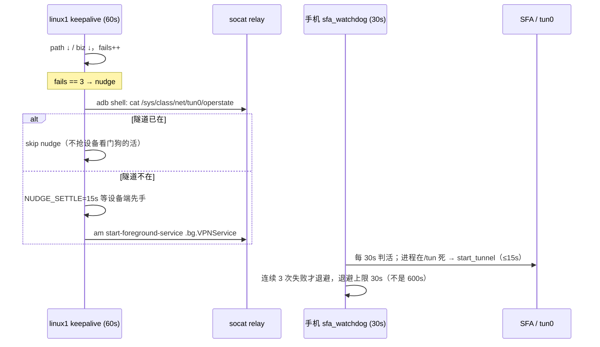

# OPS — redmi-wxpad 导出端点的可用性守护

本文只讲**链路可用性**：手机（redmi-wxpad）→ tailnet → linux1 消费者。
数据面契约见 [`DATA_CONTRACT.md`](DATA_CONTRACT.md)，部署见 [`DEPLOY.md`](DEPLOY.md)。

> **状态（2026-11-20）：导出监控与告警已暂停，可一键恢复。** 青龙 `wx_export_check`（id8）、host `redmi-tailnet-keepalive.timer`、手机 `sfa_watchdog.sh` 三项已停用；**导出能力未下线**——`wx_daemon`（监听 `127.0.0.1:8765`）与 `wx_watchdog.sh` / `wx_autostart.sh`、微信本体保持运行。本文其余章节（时序、部署、守卫）保留为可用与恢复依据；up/down runbook 见 [§5.1](#51-状态变更与恢复2026-11-20)。

## 1. 角色

| 位置 | 组件 | 职责 |
|---|---|---|
| 手机 | `wx_daemon` (`127.0.0.1:8765`) | 导出服务本体（鉴权、失败关闭） |
| 手机 | SFA / sing-box (`io.nekohasekai.sfa`) | tailnet 出口隧道，提供 `100.80.174.96` |
| 手机 | [`deploy/device/sfa_watchdog.sh`](../deploy/device/sfa_watchdog.sh) | Magisk `service.d` 常驻：解锁门禁 + 隧道自愈 |
| linux1 | [`deploy/host/redmi-tailnet-keepalive`](../deploy/host/redmi-tailnet-keepalive) | 60s 探针：路径 + 业务双判据、第 3 轮 adb 直启、报警 |
| linux1 | `socat` relay (`100.67.218.81:5555` → `Redmi-10X.lan:5555`) | 独立于 tailnet 的 adb 控制/回退通道 |

## 2. 就绪判据（两条独立判据，缺一不可）

| 判据 | 表达 | 说明 |
|---|---|---|
| `path` | `tailscale ping 100.80.174.96` 有 pong | tailnet 可路由（DERP 或 direct） |
| `biz` | `GET http://100.80.174.96:8765/health` 返回**任意** HTTP 状态码 | 401/403 也算活着；仅连接失败/超时记 `000` |

`biz` 之所以不要求 200：本仓库部署的 daemon 对 `/health` 也可能返回 401，
把判据写成"非 000 即活"才不会因鉴权策略收紧而误报（历史漂移见 §6）。

## 3. 自愈时序



关键不变量：

* **解锁门禁**：`am get-started-user-state 0 == RUNNING_UNLOCKED` 之前不碰 SFA。
  `/data` 在 FBE 凭据加密区，锁屏时 SFA 打开 Room/SQLite 必然 `SQLITE_CANTOPEN`。
* **先判设备再动作**：host 端 nudge 前先读设备 `tun0`，并在 `NUDGE_SETTLE` 后复查；
  两次 `startForegroundService` 并发会触发 `ForegroundServiceDidNotStartInTimeException`（ANR 杀进程）。
* **退避有界**：600s 退避会把"用户已解锁"这件事晾 6 分钟，上限固定 30s。
* **判活分离**：进程活 ≠ 隧道活；`tun0` 存在且 `operstate != down`（Android 上常为 `unknown`，视为 UP）。

## 4. 部署

```bash
# linux1
scp deploy/host/redmi-tailnet-keepalive linux1:/tmp/
ssh linux1 'sudo install -m 0755 /tmp/redmi-tailnet-keepalive /usr/local/bin/'

# 手机（经 relay；改前先备份）
A="adb -s 100.67.218.81:5555"
$A push deploy/device/sfa_watchdog.sh /data/local/tmp/sfa_watchdog.sh.new
$A shell 'su -c "cp -a /data/adb/service.d/sfa_watchdog.sh /data/local/tmp/$(date +%s).bak
  && install -m 0755 /data/local/tmp/sfa_watchdog.sh.new /data/adb/service.d/sfa_watchdog.sh"'
# 重启看门狗：kill $(cat /data/local/tmp/sfa_watchdog.pid)，再 setsid nohup sh 启动
```

两个脚本的所有路径与节拍都可用环境变量覆盖（`SFA_*` / `KEEPALIVE_*`），
测试依赖这些 seam 在 stub PATH 下驱动状态机，见
[`tests/test_ops_scripts.py`](../tests/test_ops_scripts.py)。

## 5. 故障史（证据）

| 日期 | 现象 | 根因 | 修复 |
|---|---|---|---|
| 2026-10-23 | 青龙 3 轮超时，`tx` 有量 `rx` 为 0 | WiFi 重连后 tailscaled 持有陈旧 direct endpoint；设备看门狗只校验进程/tun0 | 设备侧加 tailnet 探测 + 冷却重启；host 侧加 keepalive |
| 2026-11-04 | 92 分钟不可用，探针连续 95 轮失败 | 19:50 重启后 SFA 在 **FBE 锁屏态** 被盲拉，7 连崩且 `SQLITE_CANTOPEN`；600s 退避又把 21:22:58 的解锁晾到 21:29 | 解锁门禁 + 退避上限 30s + host nudge 改为真实 `am start-foreground-service` |

### 5.1 状态变更与恢复（2026-11-20）

**定性**：暂停**导出监控与告警**，**不是**下线导出能力。手机侧 `wx_daemon`、`wx_watchdog.sh`、`wx_autostart.sh` 与微信本体**保持运行**。

一键切换（host 侧 [`deploy/host/wxpad-export-toggle`](../deploy/host/wxpad-export-toggle)，随 [`deploy/install-systemd.sh`](../deploy/install-systemd.sh) 装到 `/usr/local/bin/`）：

```bash
wxpad-export-toggle status   # 只读：报告监控层三项 + 顺带报告导出本体 wx_daemon（本工具不管理它）
wxpad-export-toggle down     # 暂停监控层（青龙自检 + host 探针 + 手机隧道守护）
wxpad-export-toggle up       # 启用三项，恢复监控
```

`up` / `down` / `status` **幂等、可逆**；本工具**只**切换监控层三项，**绝不触碰导出能力本体**。它分别切换：

| 组件 | down | up |
|---|---|---|
| 青龙 `wx_export_check`（id8） | `PUT /open/crons/disable [8]`（`Crontabs.isDisabled=1`） | `PUT /open/crons/enable [8]` |
| host `redmi-tailnet-keepalive.timer` | `systemctl disable --now redmi-tailnet-keepalive.timer`（disabled / inactive） | `systemctl enable --now redmi-tailnet-keepalive.timer` |
| phone `sfa_watchdog.sh` | 改名 `…/service.d/sfa_watchdog.sh.disabled` 并 kill 常驻进程 | 改回 `sfa_watchdog.sh` 并 `setsid nohup sh …` 重启看门狗 |

路径/标识可用 `WXPAD_*` 环境变量覆盖（测试与迁移 seam，见脚本头部）。回归测试 [`tests/test_export_toggle.py`](../tests/test_export_toggle.py)（`python3 tests/test_export_toggle.py`，5 例，stub PATH 驱动 up/down/status 状态机）。

保留未删：青龙脚本与日志、`redmi-tailnet-keepalive.{service,timer}` 与 `/usr/local/bin/redmi-tailnet-keepalive`、手机备份 `/data/local/tmp/sfa_watchdog.sh.disabled-20261120-142617`。

## 6. 已知限制（不要用"自动恢复"承诺掩盖）

* **锁屏时无解**：FBE 未解锁前任何自动补救都不可能成功。告警文案必须写"需人工解锁"。
* **ANR 窗口**：force-stop 后首次 `startForegroundService` 可能因初始化超 5s 被杀；
  每 30s 重试一次即可自愈（实测注入后 46s 恢复）。
* **relay 依赖 DHCP 名**：`socat` 目标为 `Redmi-10X.lan`；请在路由器为该机固定租约，
  否则 IP 漂移会同时打断控制通道与 LAN 回退。
* **文档漂移**：`DATA_CONTRACT.md` 声明 `/health` 免鉴权，实测部署实例返回 401。
  探针口径以"非 000 即活"为准，两者需保持同步。
## 7. 微信登录面板自愈（wechat-login-guard）

**不变量：绝不点击真二维码。** 真二维码需要人拿手机扫；点它的区域不但无效，还可能落到
「切换账号」/「仅传输文件」上。守卫 [`deploy/host/wechat-login-guard`](../deploy/host/wechat-login-guard)
只在下列四条**同时**成立时点一次：

| # | 门 | 判据 |
|---|---|---|
| 1 | 几何 | 窗口 `292x396 ±8`；宽度 >800 视为已登录，直接退出且不抓像素 |
| 2 | 像素（硬否决） | 二维码卡片是灰色骨架占位：均值 55–100、σ<80、`>200` 占比<0.15、`<70` 占比<0.70、每行水平跳变<8 |
| 3 | OCR 主判据 | tesseract `chi_sim` 在按钮区域（窗口相对 `30..262 × 282..332`，`--psm 7`）读出「进入微信」；读不出时再用整窗 OCR（`--psm 6`）回退。允许 1 个字符的识别噪声，空白/全角空格先归一化 |
| 4 | OCR 否决 | 全窗口**没有**「扫码登录」/「切换账号」/「仅传输文件」 |

像素分类器是硬否决：OCR 说「进入微信」也不算数——误 OCR 永远点不进真二维码。
任一条不满足就不点，并在 journal 打一条 `event=human_required`（每 boot 只报一次）。

点击点：窗口相对 `+145,+306`，绝对坐标由 `xwininfo` 的窗口原点推出（2026-11-16 实测原点
`+494,+202`，即绝对 `+639,+508`；重启后原点不固定，运行时才算）。点完把指针挪到 `20,780`
（避免污染后续截图），等 `GUARD_SETTLE_SEC`（默认 20s），再读几何：宽度 >800 才算恢复。
限流：每 boot 最多 3 次点击，两次之间至少 600s（`/var/lib/wechat-login-guard/state.json`）。

### 7.1 安装（linux1）

```bash
scp deploy/host/wechat-login-guard linux1:/tmp/
scp deploy/systemd/wechat-login-guard.service deploy/systemd/wechat-login-guard.timer linux1:/tmp/
ssh linux1 'sudo install -m 0755 /tmp/wechat-login-guard /usr/local/bin/
  sudo install -m 0644 /tmp/wechat-login-guard.service /tmp/wechat-login-guard.timer \
                     /etc/systemd/system/
  sudo systemctl daemon-reload
  sudo systemctl enable --now wechat-login-guard.timer'
```

`StateDirectory=wechat-login-guard` 由 systemd 创建并 chown 给 `User=steven`。
若该目录缺失或不可写，脚本会退回 `/tmp`——在 `PrivateTmp=yes` 下每次调用都是新 /tmp，
点击预算等于失效；所以**不要**删这个 `StateDirectory=` 行。

### 7.2 只读验证

```bash
ssh linux1 'sudo -u steven DISPLAY=:99 /usr/local/bin/wechat-login-guard --check'   # 不点，只报告
ssh linux1 'systemctl list-timers wechat-login-guard.timer --all --no-pager'
```

`--check` 打印的就是生产同格式的决策行：

```
wechat-login-guard: level=info event=login_panel_skeleton geometry=292x396+494+202 \
  stats=(mean=81.1,std=54.2,trans=3.70,hi=0.05,lo=0.45) action=would_click \
  outcome=dry_run(pending) ocr=ok ocr_text="进入微信"
```

`geometry=` 是 `宽x高+X+Y`（窗口绝对原点），`stats=(mean,std,trans,hi,lo)` 是二维码卡片
（窗口相对 `104..190 × 76..157`）的标定向量——客户端改版后据此重新标定阈值。

### 7.3 读 journal

```bash
ssh linux1 'journalctl -u wechat-login-guard.service -n 20 --no-pager'
```

| event | 含义 | 处置 |
|---|---|---|
| `logged_in` | 宽度 >800，已登录，不碰像素 | 无 |
| `login_panel_skeleton` → `click_restored` | 已点击，窗口恢复到 >800 | 无（点击预算清零） |
| `click_ineffective`（退出码 3） | 点了但仍是登录页 | 设备会话大概已失效，等人 |
| `qr_like` / `ocr_veto` / `ocr_no_label` | 真二维码或 OCR 有歧义，**未点** | 需人工扫码，见 §7.4 |
| `rate_limited` | 本 boot 已点 3 次或距上次 <600s | 说明前面几次都没成功，等人 |
| `capture_failed`（退出码 2） | ffmpeg 抓帧失败 | 查 `DISPLAY=:99`、X 权限 |
| `ocr=unavailable` | 没有 `chi_sim` 语言包，退化为纯像素判定 | 装 `tesseract-ocr-chi-sim` |
| `locked` | 上一轮仍在运行 | 正常竞争，忽略 |

### 7.4 回滚

```bash
ssh linux1 'sudo systemctl disable --now wechat-login-guard.timer
  sudo rm -f /etc/systemd/system/wechat-login-guard.service \
             /etc/systemd/system/wechat-login-guard.timer
  sudo systemctl daemon-reload
  sudo rm -rf /var/lib/wechat-login-guard'
```

### 7.5 已知限制（不要用"自动恢复"承诺掩盖）

* **真扫码无解**：设备会话真丢了只剩真二维码，而 Xvfb `:99` 不可见。守卫只会把它曝光成
  `event=human_required`（每 boot 一次），不会替你扫码；处置仍是临时投屏或重新登录设备。
* **OCR 依赖语言包**：linux1 实测 tesseract 5.5.0 含 `chi_sim`/`eng`/`osd`。缺 `chi_sim` 时
  守卫自动退化为纯像素判定，并在 journal 标注 `ocr=unavailable`（安全方向变窄，不是变宽）。
* **像素阈值是标定值**：微信客户端重画登录面板后需用 `--check` 打出的向量重新标定。
  错标定的代价是"少点"（人被迫介入），不是"乱点"。
* **`User=` 必须与 Xvfb 属主一致**：`steven` 拥有 `/tmp/.X99-lock`，换 user 后 `xwininfo`
  会认证失败并把每一轮都记成 `capture_failed`。
