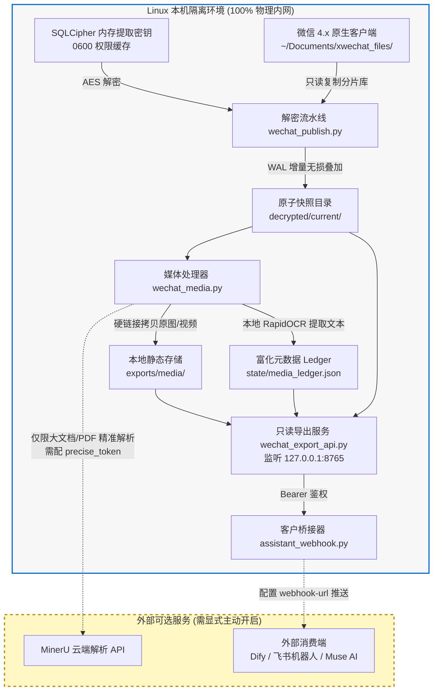

# 数据隐私与数据流向白皮书 (Privacy Policy)

微信聊天记录是用户最核心的个人资产与敏感隐私。本文档使用清晰的数据流向图与边界规范，阐明数据在何处流转、哪些阶段会离开物理主机、以及如何彻底切断任何外部网络交互。

---

## 1. 核心架构与数据流向图 (Data Flow Diagram)



---

## 2. 哪些环节会离开本机？(Outbound Boundaries)

在默认安装与标准离线运行配置下，**没有哪怕 1 个字节的聊天记录会离开本机**。只有以下两个在功能上有明确外部集成需求的可选环节，才会产生出站网络流量：

| 外部环节 | 涉及数据 | 默认状态 | 触发条件与目标地址 |
| :--- | :--- | :--- | :--- |
| **MinerU 文档云端解析** | 聊天中接收到的 PDF/Office 附件内容 | **关闭**（免 Token 通道仅使用轻量本地规则，`precise.enabled=false`） | 用户在 `media_policy.json` 中配置 `precise.token_file` 并显式开启云端模型时，仅把对应文档二进制发往 MinerU 官方解析接口。 |
| **Assistant Webhook 推送** | 格式化后的聊天事件流、会话名称、OCR 文本或原图链接 | **关闭** | 用户在 CLI 中传入 `--webhook-url`（如 Dify、飞书 Webhook 或外部 Muse AI 实例）并启动 `assistant_webhook.py`。 |

---

## 3. 如何彻底关闭外部通信 (100% Air-gapped Setup)

如果您希望确保系统绝对纯本地运行，杜绝任何外部流量风险，请遵循以下三步：

1. **禁用媒体云端精准解析**：
   在 `config/media_policy.json` 中保持：
   ```json
   {
     "precise": {
       "enabled": false,
       "token_file": null
     }
   }
   ```
   如此配置下，即便遇到大型 PDF 附件，系统也会仅使用本地规则截断或直接忽略，绝不联网发起 HTTP 请求。

2. **不配置任何外部 Webhook**：
   - 不启动 `assistant_webhook.py`；
   - 消费端（如早报智能体或本地 Coding Agent）直接通过 `127.0.0.1:8765` 本地回环接口主动轮询，或使用只读命令行客户端 `clients/fetch_export.py` 将数据写入本机临时 JSON 文件处理。

3. **网络防火墙单向锁定**：
   通过 Linux `iptables` 或 `ufw` 限制运行微信和导出服务的服务端口仅允许回环通信：
   ```bash
   sudo ufw deny 8765
   sudo ufw allow in on lo to 127.0.0.1 port 8765
   ```
